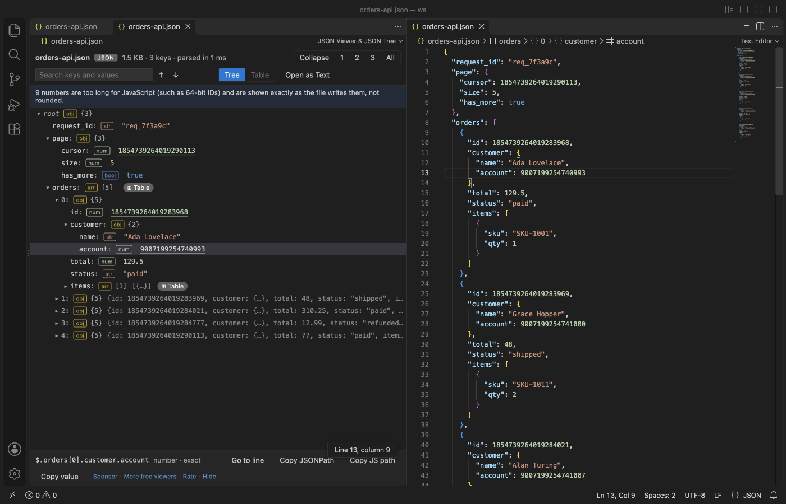
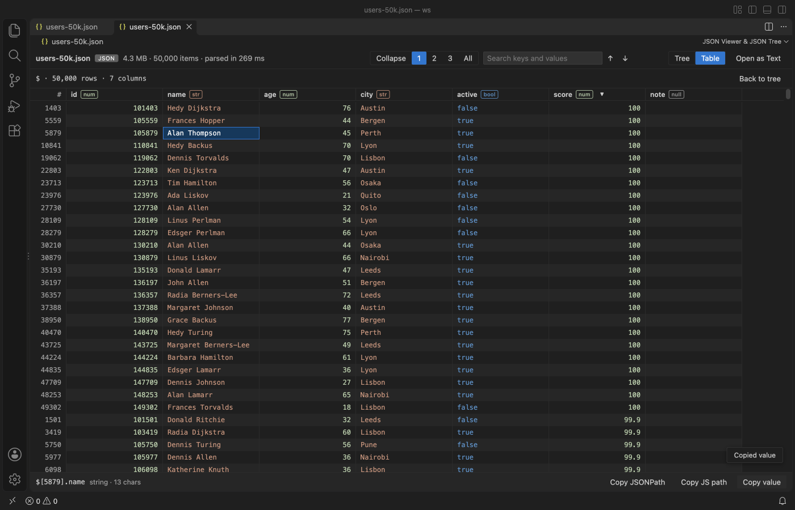
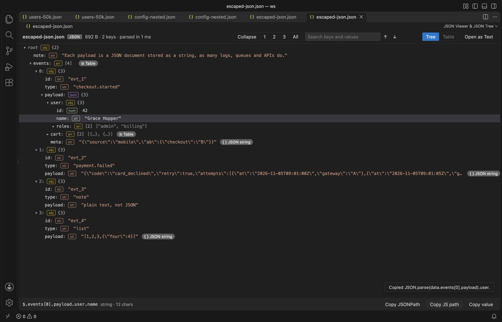
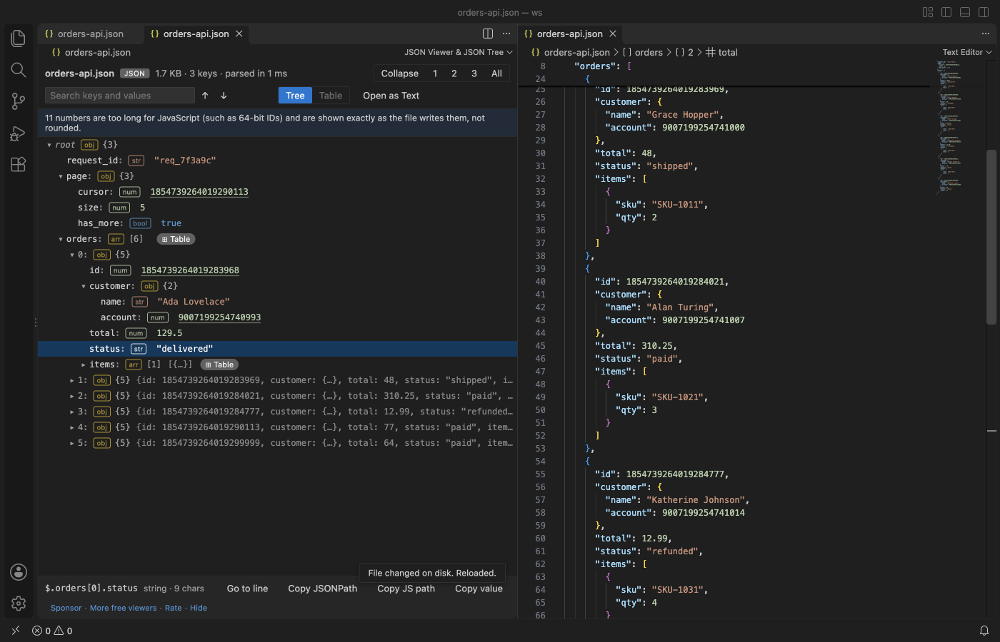
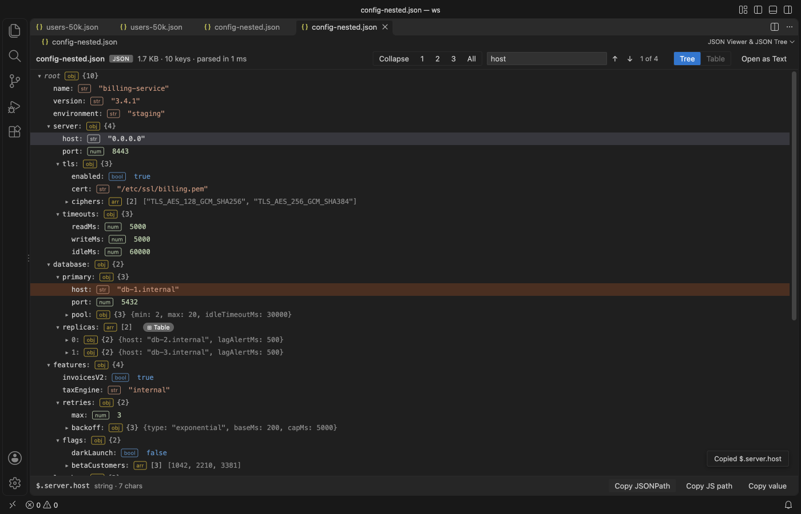
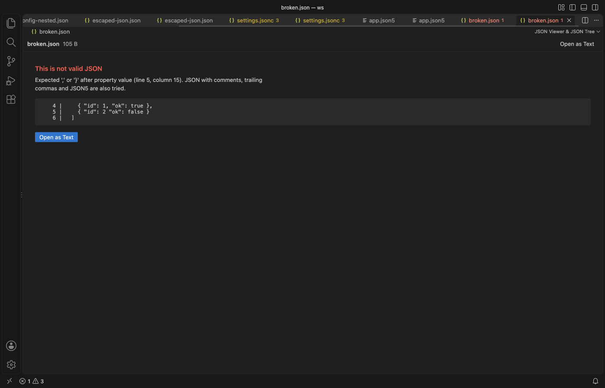
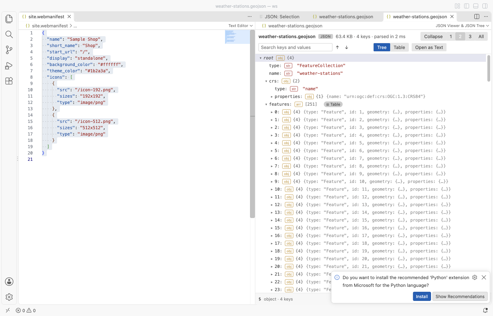

# Large JSON Viewer & JSON Tree

A large JSON viewer for VS Code with a fast JSON tree. See any JSON file as a searchable tree, copy the path of any value in one click, and turn arrays of objects into a sortable table.

*A real VS Code window (1.142, Dark Modern) with the packaged extension installed. Go to line opened the text editor beside the tree. The files are generated, so no real data appears.*

- It stays quick on big files. A worker thread parses the file, and the view only draws the rows on screen. In the test suite a 30 MB array with 350,000 objects shows its first rows in about 0.6 s, and a search of the whole file takes under 0.1 s.
- It answers "where is this value?" Search keys and values with next and previous. Click any node to see its JSONPath (`$.items[3].id`), then copy it, the JS path (`data.items[3].id`) or the value.
- It keeps big numbers exact and follows the file. 64-bit IDs such as `18446744073709551615` show digit for digit, where JSON.parse would round them. Go to line (or G) puts the text editor beside the tree with the cursor on the selected node, and the tree reloads when the file changes, with open nodes, the selection and the search kept.
- It opens what other viewers leave as text. Arrays of objects become a table with sortable columns. Strings that hold escaped JSON, such as log payloads and HAR response bodies, open as a nested tree. Comments, trailing commas and JSON5 are accepted.

## Quick start

1. Open a `.json`, `.jsonc`, `.json5`, `.geojson`, `.har`, `.ipynb` or `.webmanifest` file and click the tree icon at the top right of the editor.
2. Click nodes to expand them, or use the 1, 2, 3 and All buttons. Type in Search and press Enter.

The normal text editor stays the default, so editing works as before. To view JSON that is not saved in a file, select it (or copy it) and run "JSON Viewer: Open Selection or Clipboard in JSON Viewer".

## What you can do

| | |
|---|---|
|  |  |
| Table of an array of objects, sorted by score | Escaped JSON string opened as a tree |
|  |  |
| Reloaded after a change on disk, open nodes kept | Search keys and values |
|  |  |
| Clear error with line and column | Follows your theme, light or dark |

### Tree

Each row shows the key, a type badge (obj, arr, str, num, bool, null) and the child count. Closed objects show a short preview such as `{host: "0.0.0.0", port: 8443, tls: {…}}`. Expand to level 1, 2, 3 or all, or collapse to the root. Arrow keys move, Right opens, Left closes or goes to the parent, Enter toggles.

### Search

Search covers every key and value in the file, not only the open rows, and ignores case. Enter or ↓ goes to the next match, Shift+Enter or ↑ goes back. The tree opens the parents of each match and highlights the matching rows.

### Copy

The bottom bar shows the selected node's JSONPath and type. Copy JSONPath, Copy JS path and Copy value put it on the clipboard. Keys that are not plain names are quoted, as in `$['odd keys']` and `data["odd keys"]`. Strings are copied as plain text and everything else as formatted JSON.

### Go to line

Select a node or a table cell and click Go to line, or press G. The text editor opens beside the viewer with the cursor on that key or item. Inside an escaped JSON string it goes to the string. It works for JSON and JSONC files. JSON5 files show a short note instead.

### Reload on change

When the file changes on disk, or you save it in VS Code, the tree reads it again within about half a second. Open nodes, the selected node, the scroll position, the search and an open table stay as they were. If the new text is not valid JSON (for example while a tool is still writing it), the last good version stays on screen with a note. A tab in the background reloads when you show it. Turn this off with `jsonTreeViewer.autoReload`.

### Exact big numbers

JavaScript keeps about 15 to 17 significant digits, so JSON.parse turns `12345678901234567891` into `12345678901234567000`. This viewer reads such numbers again from the file text and shows them exactly, with a dotted underline. Copy value, search, the table and Copy value of a parent object all use the exact digits. A note at the top says how many numbers were kept this way. Sorting a table column orders them by their rounded value.

### Table

Arrays of objects get a Table chip, and a root array opens from the Table tab. There is one column per key, with its type. Click a header to sort it up, again to sort it down, and a third time to clear the sort. Missing values sort last. Click a cell to get its path and copy its value.

### Escaped JSON

When a string holds a JSON object or array, the row gets a JSON string chip. Click it to read the string as a tree. Paths inside it come out as `JSON.parse(data.events[0].payload).user.id`.

### Formats

`.json`, `.jsonc` (comments and trailing commas), `.json5`, `.geojson`, `.har`, `.ipynb` and `.webmanifest` open from the editor title or the Explorer menu. Any other file opens through the command "JSON Viewer: Open in JSON Viewer". UTF-8 and UTF-16 files with a byte order mark both work.

## Settings

| Setting | Default | What it does |
|---|---|---|
| `jsonTreeViewer.maxFileMB` | 200 | Largest file the viewer reads. Bigger files show a message and are not read. Parsing takes several times the file size in memory. |
| `jsonTreeViewer.autoReload` | true | Reload the tree when the file changes on disk or is saved. Open nodes, the selection and the search stay. |
| `jsonTreeViewer.askForRating` | true | Ask one time for a Marketplace rating after a few days of use. |

## Privacy

The extension works offline. It makes no network calls and has no telemetry. The viewer page has a strict Content Security Policy with no remote sources, and all file text is shown as text, never as HTML. Files are opened read-only.

## Limits

- Files over 200 MB (the setting goes up to 1 GB) are not opened. Use the text editor or a streaming tool such as jq for those.
- Expand all stops at 1,000,000 visible rows, and search stops at 10,000 matches. Both show a note when that happens.
- Numbers too long for JavaScript are shown exactly in JSON and JSONC files. In JSON5 files they are rounded, as in JSON.parse.
- The table shows the first 200 keys as columns.
- JSONPath for nodes inside an escaped JSON string just continues the outer path. Use the JS path for an exact address.

## Support Zovo

Zovo extensions are free, with no ads and no tracking. They are made by [theluckystrike](https://github.com/theluckystrike) on GitHub. If this one saves you time, you can support the work:

- [Sponsor on GitHub](https://github.com/sponsors/theluckystrike)
- [Follow theluckystrike on GitHub](https://github.com/theluckystrike)

## More tools by Zovo

- [JSONL Viewer & NDJSON Viewer (JSONL Table)](https://marketplace.visualstudio.com/items?itemName=zovo.zovo-jsonl-viewer) opens JSONL and NDJSON files as a table, as records or as a chat view.
- [CSV Viewer, Excel Viewer (XLSX) & Parquet Viewer](https://marketplace.visualstudio.com/items?itemName=zovo.table-viewer-vscode) opens CSV, TSV, Excel and Parquet files as a sortable, filterable table.
- [SQLite Viewer & DB Viewer (Read-Only)](https://marketplace.visualstudio.com/items?itemName=zovo.sqlite-table-viewer) browses SQLite tables read-only and runs SELECT queries.
- [Graphviz Preview & DOT Viewer](https://marketplace.visualstudio.com/items?itemName=zovo.zovo-graphviz-preview) shows a live preview of DOT files and exports SVG or PNG.
- [Claude Code History & Codex History Viewer](https://marketplace.visualstudio.com/items?itemName=zovo.agent-session-viewer) browses and searches your local Claude Code and Codex sessions.

See [all Zovo extensions on the Marketplace](https://marketplace.visualstudio.com/publishers/zovo).

## License

MIT. JSON5 parsing uses the json5 package (MIT), listed in THIRD-PARTY-NOTICES.txt.
